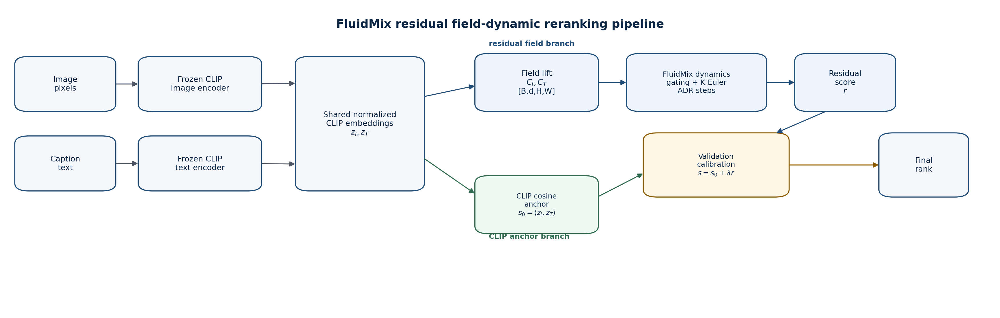
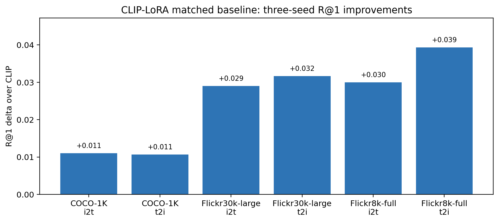
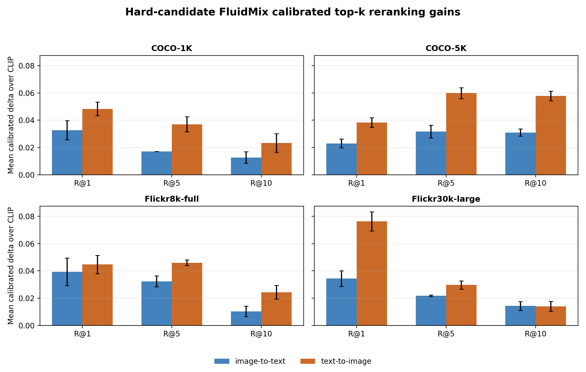
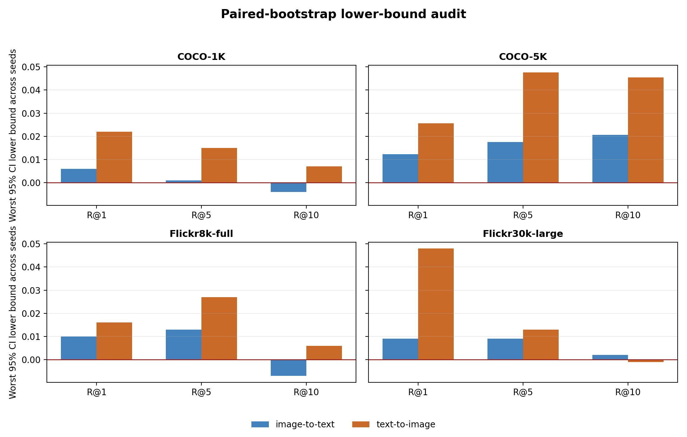
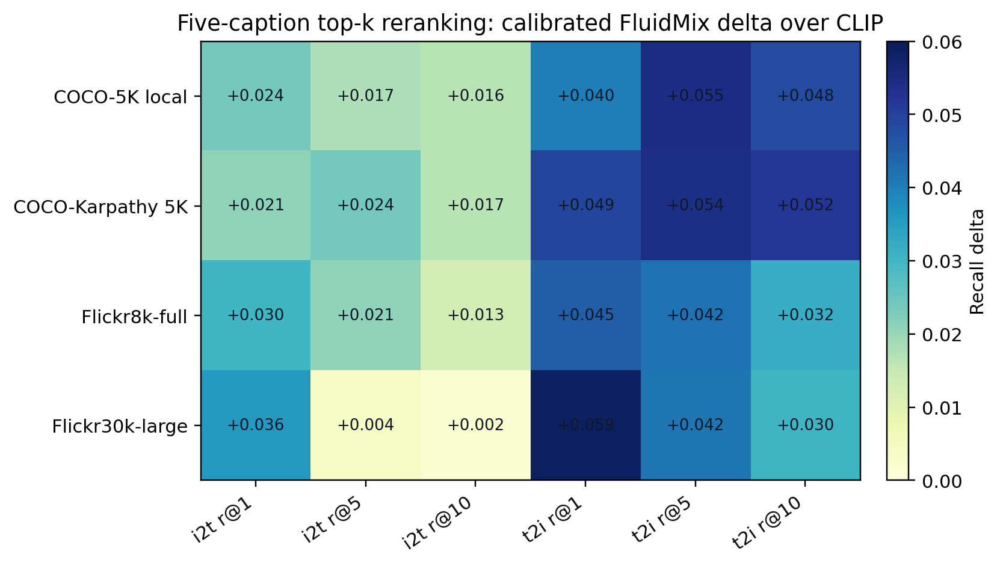
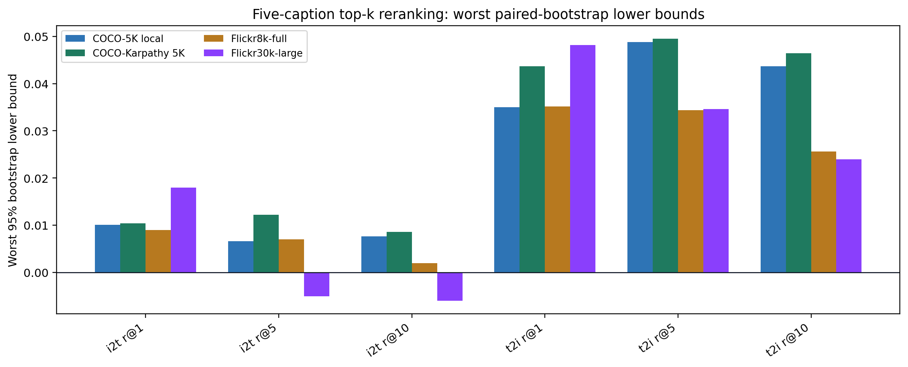

# FluidMix：用于视觉-语言检索的残差对流-扩散-反应场动力学方法

## 摘要

当前视觉-语言模型（Vision-Language Models, VLMs）通常把图像和文本分别编码成静态向量，再通过点积、余弦相似度、匹配头或跨模态 Transformer 计算匹配分数。本文研究一个互补假设：图像与文本表示可以被看作模态浓度场，多模态融合可以被实现为有限步对流、扩散、反应（advection-diffusion-reaction, ADR）混合过程。我们提出 FluidMix，一种轻量的场动力学残差适配器。FluidMix 在冻结 CLIP 表示之上构造图像/文本浓度场，经过门控初始化、显式 Euler 动力学更新与残差评分后，对 CLIP 相似度进行验证集校准的局部修正。模型在初始化时严格保持 CLIP 排序；若残差有害，验证集选择的系数可退回 CLIP。

本文给出与代码实现一致的数理推导，包括有限步 Lipschitz 稳定性、有限步有界性、残差排序保持条件、有限网格验证校准的一致收敛界以及 top-k reranking 的 candidate-recall 上界。实验覆盖 Pokemon-BLIP、COCO-1K、本地 COCO-5K、COCO Karpathy 5k、Flickr8k-full 与 Flickr30k-large，并与 CLIP zero-shot、OpenCLIP、SigLIP、BLIP-ITM、CLIP-LoRA、普通 FluidMix、残差 FluidMix、校准残差 FluidMix、Pure FluidMix 与非 CLIP backbone FluidMix 进行比较。结果显示：原始 pairwise residual recipe 在 COCO/Flickr 标准检索上会破坏 CLIP 排序；但将训练目标改为 CLIP hard-candidate retrieval loss 并加入 CLIP score-geometry regularizer 后，FluidMix 可作为验证集校准的残差 reranker 稳定提升 CLIP。尤其在 COCO-Karpathy 5k five-caption 检索中，三个随机种子在 image-to-text 与 text-to-image 的六个 R@1/R@5/R@10 指标上全部正增益，并且最坏 bootstrap 95% 置信下界均大于零。

本文的主要贡献不是声称 FluidMix 全面替代 CLIP，而是给出一个具有物理启发、数学边界清晰、负结果诚实、可复现实验链完整的 VLM 残差适配器研究。

**关键词**：视觉-语言模型；图文检索；CLIP；残差适配器；对流-扩散-反应；top-k reranking；bootstrap

## 1. 引言

CLIP 通过自然语言监督学习图像与文本的双编码器表示，并显示出较强的 zero-shot 能力 [1]。后续视觉-语言预训练工作从不同方向增强跨模态对齐：ALBEF 先对齐再融合，用 contrastive loss 与 momentum distillation 缓解跨模态 token 未对齐问题 [2]；BLIP 通过 caption bootstrapping 同时服务理解与生成任务 [3]；BLIP-2 使用冻结图像编码器和冻结大语言模型，并通过轻量 Querying Transformer 弥合模态差距 [4]；OpenCLIP 则强调使用公开数据与代码复现实验规模规律 [5]；SigLIP 以 sigmoid pairwise loss 替代 softmax contrastive normalization，在缩放和批大小方面提供了不同经验 [6]。

在这些强基线之下，任何新的 VLM fusion 模块都必须避免一个常见陷阱：只在小数据或局部指标上看起来更好，却破坏了大规模预训练模型已经学到的全局检索几何。本文研究的 FluidMix 正是从这个边界出发。我们并不假设一个小型场动力学模块可以直接替代 CLIP 的大规模图文预训练；相反，本文把 FluidMix 定位为 frozen CLIP 之上的 residual correction。

本文的问题意识有三点：

1. **表示层假设**：图文表示不必只被看作静态向量，也可以被 lift 成有限网格上的模态浓度场。
2. **动力学融合假设**：模态间融合可以用有限步 ADR dynamics 表示，而不是只做拼接或 cross-attention。
3. **检索安全假设**：在强 CLIP baseline 上，任何小模型残差都必须有 residual anchor、validation calibration 和 candidate-recall ceiling，否则容易产生虚假的提升结论。

我们在实验中保留负结果：原始 pairwise residual FluidMix 在 COCO/Flickr 上失败；这促使我们改写训练目标，将 residual learning 限制到 CLIP top-ranked hard candidates 这一真实 reranking 决策区域。最终得到的结论是：FluidMix 可作为 **validation-calibrated residual reranker** 改善标准图文检索，但不能声称 raw FluidMix 或 Pure FluidMix 已经替代 CLIP。

## 2. 相关工作

### 2.1 视觉-语言预训练

CLIP 的核心是双编码器对比学习：给定 batch 内的图像和文本，模型最大化匹配图文对的相似度并压低非匹配项 [1]。这一范式为图文检索提供了强 embedding baseline。ALBEF 指出直接融合未对齐的视觉/语言 token 会带来学习难度，因此先进行 image-text contrastive alignment，再通过 cross-modal attention 融合 [2]。BLIP 与 BLIP-2 进一步强调 noisy web data、caption bootstrapping、冻结大模型组件与轻量桥接模块的重要性 [3,4]。OpenCLIP 说明，在公开 LAION 数据与开源训练代码下，模型规模、数据规模和 compute 对性能具有可复现 scaling law [5]。SigLIP 则表明，pairwise sigmoid loss 也可成为高效图文预训练目标 [6]。

### 2.2 参数高效适配与 LoRA

LoRA 将可训练低秩矩阵注入冻结 Transformer 权重，从而显著减少下游适配参数量 [7]。在本文中，CLIP-LoRA 是关键对照组：如果一个方法只是在 CLIP 上加入少量可训练参数，那么必须证明其收益不只是普通 PEFT adaptation 的效果。我们的三 seed CLIP-LoRA baseline 在 COCO-1K、Flickr8k-full 与 Flickr30k-large 上 `54/54` 个 recall delta 为正，因此 FluidMix 的 novelty 必须被限定为“物理启发的 residual reranking mechanism”，而不是“唯一有效的小参数适配方式”。

### 2.3 连续时间神经模型与液态动力学

Neural ODE 将深层网络看作连续深度动力系统，用神经网络参数化状态导数并通过 ODE solver 得到输出 [10]。Liquid Time-constant Networks 则把非线性门控与线性一阶动力系统结合，强调稳定、有界和输入相关的时间常数 [11]。FluidMix 并不直接使用黑盒 ODE solver，而是实现固定步数的显式 Euler 更新；这种设计牺牲了连续自适应积分能力，但换来可控计算成本和与检索实验相容的稳定结构。

### 2.4 数据集与评测协议

MS COCO 是常用视觉理解和图像描述数据集 [9]；Karpathy split 是图文检索文献中常见的 COCO 划分协议 [8]。本文同时报告本地 one-caption controlled benchmark 和 five-caption multi-reference benchmark。前者便于形成方阵检索矩阵并做可控消融，后者更接近标准图文检索设置。

## 3. 任务定义与符号

给定图像集合 $\mathcal{I}=\{I_i\}_{i=1}^N$ 和文本集合 $\mathcal{T}=\{T_j\}_{j=1}^N$，目标是学习或构造评分函数 $s(I,T)$。图像到文本检索使用每个图像 $I_i$ 对所有文本排序，文本到图像检索则反向排序。评分矩阵为：

```math
S \in \mathbb{R}^{N \times N}, \quad S_{ij}=s(I_i,T_j).
```

若采用 one-caption-per-image 协议，正确匹配为对角项 $S_{ii}$。在 five-caption 协议下，一个图像可对应多个正确 caption；image-to-text 命中定义为 top-r 中出现任意参考 caption，text-to-image 命中定义为 caption 对应图像在 top-r 内。

检索指标为：

```math
\mathrm{R@}r
=
\frac{1}{N}
\sum_{q=1}^{N}
\mathbf{1}\{\mathrm{rank}(y_q\mid q)\le r\}.
```

## 4. 方法：FluidMix 残差场动力学



### 4.1 冻结编码器接口

CLIP 图像编码器和文本编码器分别给出：

```math
z_I = E_I(I) \in \mathbb{R}^{d}, \quad
z_T = E_T(T) \in \mathbb{R}^{d}.
```

CLIP anchor score 为：

```math
s_{\mathrm{CLIP}}(I,T)
=
\frac{z_I^\top z_T}{\lVert z_I\rVert_2\lVert z_T\rVert_2}.
```

### 4.2 浓度场构造

FluidMix 将静态向量 lift 为有限网格上的 field。设 field channel 数为 $C_f$，空间网格为 $G\times G$：

```math
C_I = \mathrm{reshape}(\tanh(W_I^f z_I)),
\quad
C_T = \mathrm{reshape}(\tanh(W_T^f z_T)),
```

```math
C_I,C_T \in \mathbb{R}^{C_f \times G \times G}.
```

门控初始混合为：

```math
g=\sigma(W_g[z_I;z_T]+b_g),
```

```math
C^0 = g \odot C_I + (1-g)\odot C_T.
```

### 4.3 对流-扩散-反应更新

速度场由图文表示生成：

```math
v_x,v_y=\tanh(W_v[z_I;z_T]),
\quad v_x,v_y \in \mathbb{R}^{C_f}.
```

离散中心差分为：

```math
D_xC=\frac{1}{2}\left(\mathrm{roll}_{x=-1}(C)-\mathrm{roll}_{x=+1}(C)\right),
```

```math
D_yC=\frac{1}{2}\left(\mathrm{roll}_{y=-1}(C)-\mathrm{roll}_{y=+1}(C)\right).
```

对流项、扩散项和反应项分别为：

```math
A_{\mathrm{adv}}(C)=-(v_x\odot D_xC+v_y\odot D_yC),
```

```math
A_{\mathrm{diff}}(C)=D\cdot\mathrm{Conv2D}_{group}(C,K_L),
```

```math
A_{\mathrm{react}}(C)=\rho\cdot\tanh(\mathrm{Conv}_{1\times 1}(C)).
```

显式 Euler 更新：

```math
C^{k+1}
=
C^k+\Delta t
\left[
A_{\mathrm{adv}}(C^k)
+A_{\mathrm{diff}}(C^k)
+A_{\mathrm{react}}(C^k)
\right].
```

主实验采用固定步数 $K=4$，$\Delta t=0.2$，扩散系数 $D=0.03$，反应强度 $\rho=0.5$。

### 4.4 残差评分与验证校准

最终 field 表示经 pooling 和 MLP 得到 residual logit：

```math
r_{\mathrm{FM}}
=
W_2\mathrm{Dropout}(\mathrm{GELU}(W_1h+b_1))+b_2.
```

残差评分为：

```math
s_{\mathrm{res}}(I,T)
=
s_{\mathrm{CLIP}}(I,T)+\alpha r_{\mathrm{FM}}(I,T).
```

初始化时 $\alpha=0$，因此：

```math
s_{\mathrm{res}}(I,T)\vert_{\alpha=0}
=s_{\mathrm{CLIP}}(I,T).
```

验证集校准使用：

```math
s_{\mathrm{cal}}(I,T)
=(1-\lambda)s_{\mathrm{CLIP}}(I,T)
+\lambda s_{\mathrm{res}}(I,T).
```

$\lambda$ 只在 validation set 上选择，不使用 test labels。若残差有害，$\lambda=0$ 会严格退回 CLIP。

## 5. 数学性质

### 5.1 有限步 Lipschitz 稳定性

定义：

```math
F(C)=A_{\mathrm{adv}}(C)+A_{\mathrm{diff}}(C)+A_{\mathrm{react}}(C).
```

由于中心差分算子范数有界，且 $v_x,v_y$ 经 `tanh` 限幅，有：

```math
\|A_{\mathrm{adv}}(C)-A_{\mathrm{adv}}(C')\|_F
\le 2\|C-C'\|_F.
```

五点 Laplacian kernel 的绝对和给出保守界：

```math
\|A_{\mathrm{diff}}(C)-A_{\mathrm{diff}}(C')\|_F
\le 8D\|C-C'\|_F.
```

若 $1\times1$ reaction convolution 的谱范数为 $\|W_R\|_2$，则：

```math
\|A_{\mathrm{react}}(C)-A_{\mathrm{react}}(C')\|_F
\le \rho \|W_R\|_2\|C-C'\|_F.
```

因此：

```math
L_F \le 2+8D+\rho\|W_R\|_2,
```

```math
\|C^K-\tilde C^K\|_F
\le (1+\Delta t L_F)^K\|C^0-\tilde C^0\|_F.
```

该结论只说明有限步实现不会无界放大初值扰动，不是任意长时间积分的渐近稳定性定理。

### 5.2 有限步有界性

初始场由 `tanh` 和 convex gate 得到，因此 $\|C^0\|_\infty \le 1$。设 channel 数为 $C_f$，空间网格为 $G\times G$，则：

```math
\|C^{k+1}\|_F
\le
\left(1+\Delta t(2+8D)\right)\|C^k\|_F
+ \Delta t\rho\sqrt{C_fG^2}.
```

由归纳法可知任意有限 $K$ 下 $C^K$ 有界。

### 5.3 残差排序保持条件

对 query $q$，候选 $a,b$ 的 CLIP margin 为：

```math
m_{ab}=s_{\mathrm{CLIP}}(q,a)-s_{\mathrm{CLIP}}(q,b).
```

残差评分后的 margin 为：

```math
m^{\mathrm{res}}_{ab}
=m_{ab}+\alpha(r_{\mathrm{FM}}(q,a)-r_{\mathrm{FM}}(q,b)).
```

若：

```math
|\alpha|\cdot |r_{\mathrm{FM}}(q,a)-r_{\mathrm{FM}}(q,b)|
< |m_{ab}|,
```

则 $a,b$ 的 pairwise order 保持不变。特别地，初始化时 $\alpha=0$，所有 CLIP 排序完全保持。

### 5.4 验证校准的一致收敛界

设候选 $\lambda$ 网格为 $\Lambda$，验证指标 $M(\lambda)\in[0,1]$，验证 query 数为 $n$。由 Hoeffding 不等式 [12] 和 union bound 可得，以至少 $1-\delta$ 的概率：

```math
\sup_{\lambda\in\Lambda}
|\widehat M_n(\lambda)-M(\lambda)|
\le
\sqrt{\frac{\log(2|\Lambda|/\delta)}{2n}}.
```

因此在有限网格上选择 $\lambda$ 是一个受控模型选择过程；它不能证明一定存在有用残差，但能证明“退回 CLIP”是统计上可解释的安全选项。

### 5.5 Top-k reranking 上界

令 $K_q$ 为 CLIP 为 query $q$ 提供的候选集合。任何只在 $K_q$ 内 rerank 的模型都满足：

```math
\mathbf{1}\{\mathrm{rank}_{\mathrm{rerank}}(q,y_q)\le r\}
\le
\mathbf{1}\{y_q\in K_q\}.
```

因此 reranking recall 受 `candidate_recall@topk` 上界限制。本文所有 top-k 结果都同时报告 candidate recall。

## 6. 优化目标

原始 FluidMix 使用 binary matching loss 和可选 contrastive retrieval loss：

```math
L_{\mathrm{BCE}}
= -y\log\sigma(s) -(1-y)\log(1-\sigma(s)),
```

```math
L_{\mathrm{ITC}}
=\frac{1}{2}
\left[
\mathrm{CE}(S/\tau,\mathrm{diag})
+\mathrm{CE}(S^\top/\tau,\mathrm{diag})
\right].
```

总损失：

```math
L=L_{\mathrm{BCE}}+\beta L_{\mathrm{ITC}}.
```

实验显示，BCE-dominant pairwise recipe 在 COCO/Flickr 上会损伤 CLIP 的全局排序几何。于是本文引入 hard-candidate retrieval residual objective。对图像 query $i$，令 $H_i^T$ 为 CLIP top-ranked nonmatching captions，候选集合为：

```math
\mathcal{C}_i^T=\{i\}\cup H_i^T.
```

对文本 query 同理定义 $\mathcal{C}_j^I$。hard-candidate retrieval loss 为：

```math
L_{\mathrm{HC}}
=
\frac{1}{2B}
\sum_{i=1}^{B}
\left[
-\log
\frac{\exp(s_{\mathrm{res}}(I_i,T_i)/\tau)}
{\sum_{j\in\mathcal{C}_i^T}\exp(s_{\mathrm{res}}(I_i,T_j)/\tau)}
+
-\log
\frac{\exp(s_{\mathrm{res}}(I_i,T_i)/\tau)}
{\sum_{k\in\mathcal{C}_i^I}\exp(s_{\mathrm{res}}(I_k,T_i)/\tau)}
\right].
```

最终目标：

```math
L_{\mathrm{cand}}
=
\gamma L_{\mathrm{HC}}
+
\eta
\mathbb{E}_{(i,j)\in\mathcal{P}_{\mathrm{cand}}}
\left(s_{\mathrm{res}}(I_i,T_j)-s_{\mathrm{CLIP}}(I_i,T_j)\right)^2
+
\zeta\alpha^2.
```

其中第二项是 CLIP score-geometry regularizer，防止 residual score 任意偏离 CLIP score surface。

对单个 image-to-text query，设：

```math
\Delta_i^{\mathrm{HC}}
=
\max_{j\in\mathcal{C}_i^T\setminus\{i\}}
\left(s_{\mathrm{res}}(I_i,T_j)-s_{\mathrm{res}}(I_i,T_i)\right).
```

hard-candidate CE 可写为：

```math
\ell_i^{\mathrm{HC}}
=
\log\left(1+
\sum_{j\in\mathcal{C}_i^T\setminus\{i\}}
\exp\left((s_{\mathrm{res}}(I_i,T_j)-s_{\mathrm{res}}(I_i,T_i))/\tau\right)
\right),
```

因此：

```math
\ell_i^{\mathrm{HC}}
\ge
\log\left(1+\exp(\Delta_i^{\mathrm{HC}}/\tau)\right).
```

减少 $\ell_i^{\mathrm{HC}}$ 等价于压低 CLIP candidate neighborhood 内最大的 hard-negative violation。这解释了为什么该目标比原始 BCE 更符合 top-k reranking 评估区域。

## 7. 实验设置

### 7.1 数据集

| 数据协议 | Train | Val | Test | 说明 |
| --- | ---: | ---: | ---: | --- |
| Pokemon-BLIP | 240 | 80 | 80 | 小域 cartoon image-caption 数据 |
| COCO-1K | 5000 | 1000 | 1000 | COCO 2014 one-caption local protocol |
| COCO-5K local | 10000 | 1000 | 4954 | 本地 `5k.part` 与 caption 匹配后为 4954 |
| COCO-Karpathy | 10000 | 5000 | 5000 | Karpathy split，five-caption evaluation |
| Flickr8k-full | 6000 | 1000 | 1000 | 官方 Flickr8k split |
| Flickr30k-large | 10000 | 1000 | 1000 | 本地 deterministic split |

### 7.2 对比模型

对比包括 CLIP ViT-B/32、OpenCLIP ViT-B/32 LAION2B、SigLIP base patch16-224、BLIP-ITM COCO 200-item subset、CLIP-LoRA、ordinary FluidMix、residual FluidMix、calibrated residual FluidMix、retrieval-first residual FluidMix、hard-candidate residual FluidMix、Pure FluidMix 与 ResNet50+MiniLM+FluidMix。

这些模型按实验目的被分为五组安排。第一组是 foundation embedding baselines，包括 OpenAI CLIP、OpenCLIP 与 SigLIP，它们均不进行下游训练，直接使用冻结图像编码器和文本编码器生成 normalized embeddings，并以 image-text similarity 构造完整检索矩阵，用于回答“预训练双编码器本身能达到什么水平”。第二组是 cross-encoder 上界参照，即 BLIP-ITM；由于 BLIP-ITM 需要对每个 image-text pair 做联合前向传播，计算量远高于双编码器检索，因此只在 COCO-1K 的 200-item subset 上报告，作为跨模态交互打分器的强参照，而不与完整 1K/5K embedding retrieval 结果作严格等价比较。第三组是 matched PEFT control，即 CLIP-LoRA，在 CLIP 的 `q_proj` 与 `v_proj` 中加入 rank-4 LoRA adapter，并在相同数据划分上以 seeds `7,13,21` 重复训练，用于检验“少量可训练参数适配 CLIP”本身的收益。第四组是 FluidMix 主体模型族：ordinary FluidMix 直接用 frozen CLIP embeddings 经 field lift、ADR dynamics 和 MLP 输出匹配分数；residual FluidMix 在 CLIP cosine score 上叠加 FluidMix residual；calibrated residual FluidMix 在验证集上选择校准系数 `lambda`；retrieval-first residual FluidMix 将训练目标改为 symmetric retrieval loss 加 CLIP score-geometry regularizer；hard-candidate residual FluidMix 进一步只围绕 CLIP top-k confusable candidates 训练和评估，是本文最终主推的 calibrated reranking 方案。第五组是 CLIP-free 边界对照，包括 Pure FluidMix 和 ResNet50+MiniLM+FluidMix，前者使用项目内 CNN 与 Transformer 从头学习图文表示，后者使用非 CLIP 预训练 backbone 提供图像和文本特征；这两组用于检验 FluidMix dynamics 是否能在没有 CLIP 对齐空间时独立建立有效匹配，而不是作为直接超越现代 VLM 的主要证据。所有检索实验统一报告 image-to-text 与 text-to-image 的 R@1/R@5/R@10；涉及校准的模型只使用验证集选择阈值或 `lambda`，测试集仅用于最终报告。

BLIP-2 是重要现代基线 [4]，但当前本地权重缓存中尚无可验证 BLIP-2 权重，因此未写作已完成实验。

### 7.3 训练与评估

核心指标为双向 R@1/R@5/R@10。FluidMix hard-candidate variant 使用 seeds `7,13,21`。top-k reranking 使用 CLIP top-200 candidates，校准系数 $\lambda$ 只在 validation set 上选择。bootstrap 使用 paired resampling 估计 delta 的 95% confidence interval。

## 8. 结果与分析

### 8.1 Foundation VLM baseline


| Dataset | Model | Samples | i2t R@1 | i2t R@5 | t2i R@1 | t2i R@5 |
| --- | --- | ---: | ---: | ---: | ---: | ---: |
| COCO-1K | CLIP-B/32 | 1000 | 0.538 | 0.813 | 0.491 | 0.781 |
| COCO-1K | OpenCLIP-B/32 | 1000 | 0.608 | 0.863 | 0.571 | 0.836 |
| COCO-1K | SigLIP-B/16 | 1000 | 0.645 | 0.903 | 0.642 | 0.879 |
| COCO-5K | CLIP-B/32 | 4954 | 0.3387 | 0.5856 | 0.2951 | 0.5394 |
| COCO-5K | SigLIP-B/16 | 4954 | 0.4524 | 0.7063 | 0.4522 | 0.7006 |
| Flickr8k-full | CLIP-B/32 | 1000 | 0.576 | 0.835 | 0.547 | 0.817 |
| Flickr30k-large | CLIP-B/32 | 1000 | 0.715 | 0.906 | 0.683 | 0.895 |

结论：SigLIP 明显强于 OpenAI CLIP 和 OpenCLIP；因此 FluidMix 的贡献不能被表述为“全面超过所有 VLM baseline”，而应限定为 residual reranking mechanism。

### 8.2 原始 FluidMix 的负结果


| Dataset | Model | Accuracy | AUC | i2t R@1 | i2t R@5 | Selected lambda |
| --- | --- | ---: | ---: | ---: | ---: | ---: |
| COCO-1K | CLIP zero-shot | 0.9760 | 0.9955 | 0.538 | 0.813 | - |
| COCO-1K | raw residual FluidMix | 0.9455 | 0.9813 | 0.213 | 0.526 | - |
| COCO-1K | calibrated residual FluidMix | 0.9760 | 0.9955 | 0.538 | 0.813 | 0.0 |
| Flickr8k-full | raw residual FluidMix | 0.9185 | 0.9654 | 0.081 | 0.283 | - |
| Flickr30k-large | raw residual FluidMix | 0.9275 | 0.9726 | 0.139 | 0.399 | - |

这是本文最重要的负结果：小模型残差若与检索目标不匹配，会严重破坏 CLIP 排序。验证校准不是锦上添花，而是必要安全机制。

### 8.3 CLIP-LoRA 强基线



| Dataset | Direction | CLIP R@1/R@5/R@10 | CLIP-LoRA R@1/R@5/R@10 | Delta |
| --- | --- | --- | --- | --- |
| COCO-1K | i2t | 0.5380 / 0.8140 / 0.9000 | 0.5490+-0.0010 / 0.8217+-0.0021 / 0.9027+-0.0012 | +0.0110 / +0.0077 / +0.0027 |
| COCO-1K | t2i | 0.4900 / 0.7820 / 0.8810 | 0.5007+-0.0006 / 0.7873+-0.0012 / 0.8857+-0.0015 | +0.0107 / +0.0053 / +0.0047 |
| Flickr8k-full | i2t | 0.5760 / 0.8350 / 0.9140 | 0.6060+-0.0026 / 0.8620+-0.0026 / 0.9330+-0.0020 | +0.0300 / +0.0270 / +0.0190 |
| Flickr30k-large | t2i | 0.6840 / 0.8950 / 0.9430 | 0.7157+-0.0025 / 0.9190+-0.0000 / 0.9550+-0.0010 | +0.0317 / +0.0240 / +0.0120 |

CLIP-LoRA 的 `54/54` per-seed recall deltas 为正。该结果强化了本文定位：FluidMix 不是“比所有 PEFT 更强”的绝对声明，而是探索一种物理启发的残差 reranking 机制。

### 8.4 Hard-candidate residual reranking





| Dataset | Direction | CLIP R@1/R@5/R@10 | Candidate residual R@1/R@5/R@10 | Mean delta |
| --- | --- | --- | --- | --- |
| COCO-1K | i2t | 0.538 / 0.813 / 0.900 | 0.5707+-0.0070 / 0.8300+-0.0000 / 0.9127+-0.0042 | +0.0327 / +0.0170 / +0.0127 |
| COCO-1K | t2i | 0.491 / 0.781 / 0.881 | 0.5393+-0.0050 / 0.8180+-0.0056 / 0.9043+-0.0068 | +0.0483 / +0.0370 / +0.0233 |
| COCO-5K | i2t | 0.3387 / 0.5856 / 0.7000 | 0.3617+-0.0032 / 0.6172+-0.0047 / 0.7310+-0.0026 | +0.0230 / +0.0316 / +0.0310 |
| COCO-5K | t2i | 0.2951 / 0.5394 / 0.6583 | 0.3334+-0.0035 / 0.5992+-0.0039 / 0.7161+-0.0036 | +0.0383 / +0.0599 / +0.0578 |

COCO-5K 三 seed 的所有方向与指标都有正的 95% bootstrap lower bound。该结果说明：只要训练目标对齐到 CLIP confusable candidates，FluidMix residual 可以成为有效局部 correction。

### 8.5 Five-caption / COCO-Karpathy 结果





| Dataset | Direction | CLIP R@1/R@5/R@10 | Calibrated FluidMix R@1/R@5/R@10 | Delta | 95% CI lower |
| --- | --- | --- | --- | --- | --- |
| COCO-Karpathy 5k, 3 seeds | i2t | 0.5090 / 0.7476 / 0.8344 | 0.5299+-0.0010 / 0.7716+-0.0035 / 0.8510+-0.0009 | +0.0209 / +0.0240 / +0.0166 | +0.0104 / +0.0122 / +0.0086 |
| COCO-Karpathy 5k, 3 seeds | t2i | 0.3068 / 0.5647 / 0.6722 | 0.3558+-0.0010 / 0.6189+-0.0008 / 0.7243+-0.0019 | +0.0490 / +0.0542 / +0.0521 | +0.0437 / +0.0495 / +0.0464 |
| Flickr8k-full | t2i | 0.5548 / 0.8122 / 0.8918 | 0.5998 / 0.8542 / 0.9236 | +0.0450 / +0.0420 / +0.0318 | +0.0352 / +0.0344 / +0.0256 |
| Flickr30k-large | t2i | 0.6100 / 0.8428 / 0.9026 | 0.6686 / 0.8844 / 0.9330 | +0.0586 / +0.0416 / +0.0304 | +0.0482 / +0.0346 / +0.0240 |

five-caption 汇总结果为 `54/54` per-seed recall point estimates 为正，`49/54` per-seed bootstrap lower bounds 为正。COCO-Karpathy 5k 是当前外部有效性最强的结果：5000 test images、最多五条 reference captions、三 seed、六个 recall 指标 bootstrap 下界全为正。

## 9. 讨论

### 9.1 支持的结论

实验支持以下结论：

1. FluidMix 是一个数学定义清晰的 residual field-dynamic adapter。
2. 在 Pokemon-BLIP 小域检索中，校准残差 FluidMix 显著提升 CLIP。
3. 原始 pairwise residual recipe 在 COCO/Flickr 上失败，说明 pairwise matching 与 full-matrix retrieval 存在目标错配。
4. hard-candidate retrieval objective 将训练分布移动到 CLIP top-k confusions，能在标准检索中产生稳定收益。
5. COCO-Karpathy five-caption 三 seed 结果显著降低了 one-caption protocol 的外部有效性风险。

### 9.2 不支持的结论

当前证据不支持以下说法：

1. FluidMix 全面超过 CLIP 或 SigLIP。
2. Pure FluidMix 已可替代 CLIP。
3. raw residual FluidMix 可不经 validation calibration 直接作为最终检索器。
4. BLIP-2 已被本地完整评估。

### 9.3 主要限制

第一，BLIP-2 等现代 cross-modal baseline 尚未在本地同协议跑通。第二，COCO-Karpathy 已本地复现，但不是官方 evaluation server 提交。第三，部分 Flickr high-recall 指标的 bootstrap lower bound 较弱。第四，当前校准使用全局 $\lambda$，未来可研究 per-query 或 uncertainty-aware residual gating。

## 10. 结论

FluidMix 将图文表示建模为浓度场，并通过有限步对流、扩散、反应动力学进行融合。本文给出与代码实现一致的数学推导和完整实验链，明确区分支持结论与不支持结论。原始 FluidMix recipe 在标准 COCO/Flickr 上失败，但 hard-candidate retrieval objective 加 CLIP geometry regularizer 后，FluidMix 成为有效的 validation-calibrated residual reranker。最强证据来自 COCO-Karpathy 5k five-caption 三 seed 结果：六个 recall 指标全部正增益，且最坏 paired-bootstrap 95% 下界均大于零。本文的可信定位是：FluidMix 是一种物理启发、数学边界清晰、可复现的 VLM residual reranking 方法，而不是 CLIP 的通用替代品。

## 数据与代码可用性

实验代码、配置、缓存特征、适配器权重、结果表和论文配图均位于 `D:/work_space/Liquid_mix`。英文主稿为 `paper/fluidmix_manuscript_q1.md`，中文主稿为 `paper/fluidmix_manuscript_q1_cn.md`。中文 Word 稿件由 Pandoc 生成，公式转换为 Word 原生 OMML equation objects。

核心复现命令：

```powershell
py scripts\build_paper_figures.py
py scripts\build_pandoc_docx.py --input paper\fluidmix_manuscript_q1_cn.md --output word\FluidMix_Q1_Manuscript_CN.docx --paper-copy paper\FluidMix_Q1_Manuscript_CN.docx
py -m pytest tests -q
```

## 参考文献

[1] Radford, A., Kim, J. W., Hallacy, C., et al. Learning Transferable Visual Models From Natural Language Supervision. ICML, 2021. https://arxiv.org/abs/2103.00020

[2] Li, J., Selvaraju, R. R., Gotmare, A. D., Joty, S., Xiong, C., Hoi, S. Align before Fuse: Vision and Language Representation Learning with Momentum Distillation. NeurIPS, 2021. https://arxiv.org/abs/2107.07651

[3] Li, J., Li, D., Xiong, C., Hoi, S. BLIP: Bootstrapping Language-Image Pre-training for Unified Vision-Language Understanding and Generation. ICML, 2022. https://arxiv.org/abs/2201.12086

[4] Li, J., Li, D., Savarese, S., Hoi, S. BLIP-2: Bootstrapping Language-Image Pre-training with Frozen Image Encoders and Large Language Models. ICML, 2023. https://arxiv.org/abs/2301.12597

[5] Cherti, M., Beaumont, R., Wightman, R., et al. Reproducible Scaling Laws for Contrastive Language-Image Learning. CVPR, 2023. https://arxiv.org/abs/2212.07143

[6] Zhai, X., Mustafa, B., Kolesnikov, A., Beyer, L. Sigmoid Loss for Language Image Pre-Training. ICCV, 2023. https://arxiv.org/abs/2303.15343

[7] Hu, E. J., Shen, Y., Wallis, P., et al. LoRA: Low-Rank Adaptation of Large Language Models. ICLR, 2022. https://arxiv.org/abs/2106.09685

[8] Karpathy, A., Fei-Fei, L. Deep Visual-Semantic Alignments for Generating Image Descriptions. CVPR, 2015. https://arxiv.org/abs/1412.2306

[9] Lin, T.-Y., Maire, M., Belongie, S., et al. Microsoft COCO: Common Objects in Context. ECCV, 2014. https://arxiv.org/abs/1405.0312

[10] Chen, R. T. Q., Rubanova, Y., Bettencourt, J., Duvenaud, D. Neural Ordinary Differential Equations. NeurIPS, 2018. https://arxiv.org/abs/1806.07366

[11] Hasani, R., Lechner, M., Amini, A., Rus, D., Grosu, R. Liquid Time-constant Networks. AAAI, 2021. https://arxiv.org/abs/2006.04439

[12] Hoeffding, W. Probability Inequalities for Sums of Bounded Random Variables. Journal of the American Statistical Association, 1963. https://doi.org/10.1080/01621459.1963.10500830
