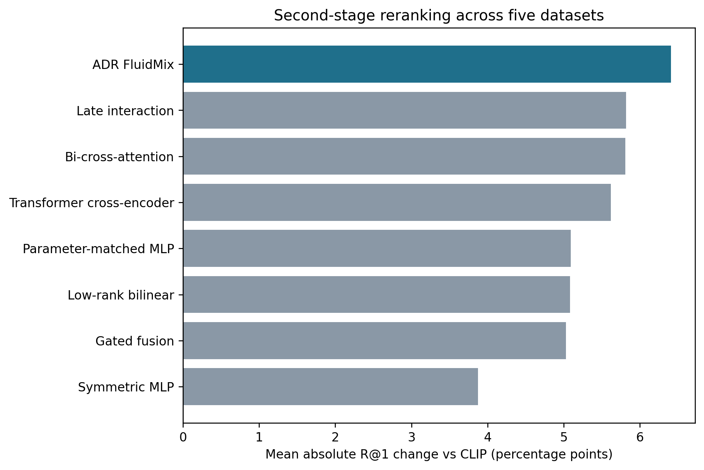
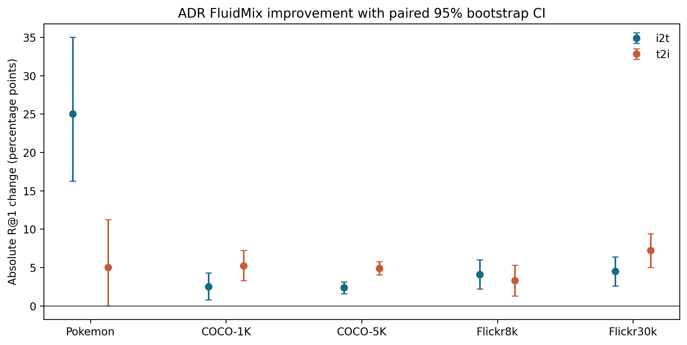
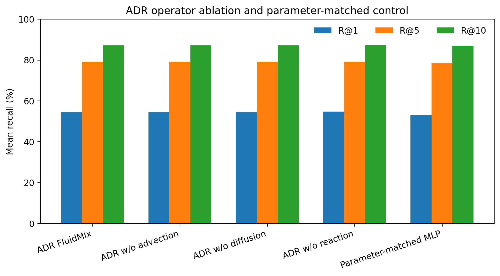
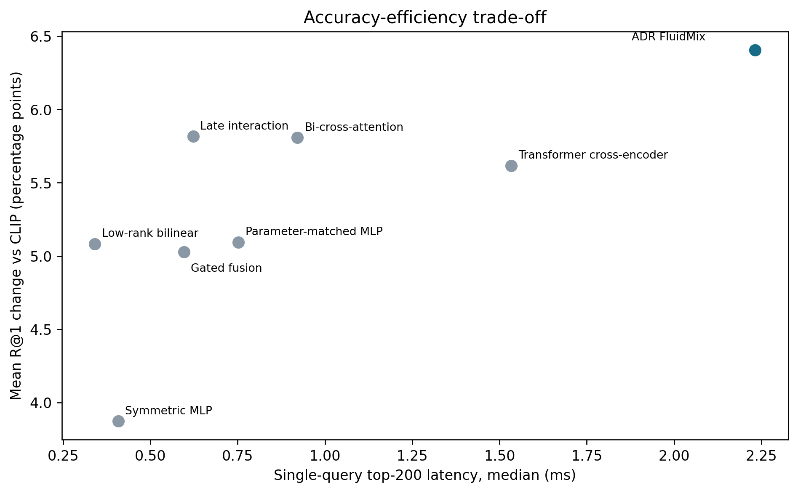
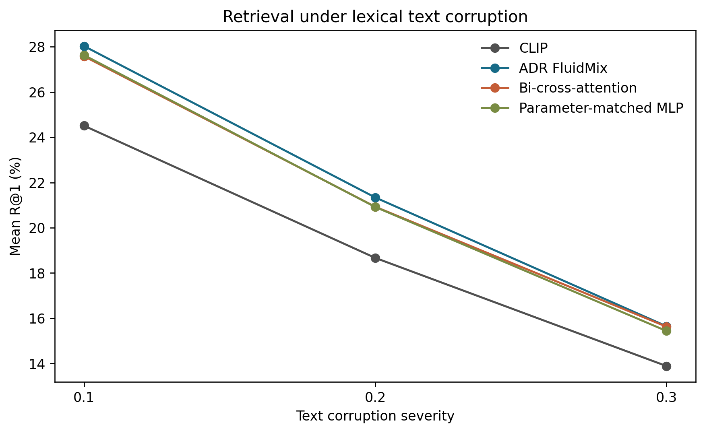

# FluidMix 新增实验的论文入稿论述

> 使用说明：本文件用于补充 `paper/fluidmix_manuscript_q1_cn.md`。建议将第 1--2 节并入论文第 7 节“实验设置”，将第 3--7 节接在原第 8.5 节之后，将第 8 节并入“讨论”，并用第 9 节更新论文结论。表号、图号请在合并主稿后统一顺延。

## 1. 统一二阶段重排协议

### 1.1 研究目的

前述实验已经证明，将 FluidMix 的训练区域限制在冻结 CLIP 的难候选集合内，可以显著缓解普通 pairwise matching 与全库检索之间的目标错配。然而，仅与冻结 CLIP、CLIP-LoRA 或 FluidMix 内部变体比较，仍不足以判断性能提升究竟来自 ADR 场动力学，还是来自任意具有额外参数的二阶段非线性重排头。为此，本文进一步构建统一的 top-\(K\) 二阶段评测框架，在候选集合、输入特征、训练负样本、损失函数、验证选择和测试封存均一致的条件下，将 ADR FluidMix 与六类常见跨模态交互机制及一个等参数容量控制进行比较。

对于查询 \(q\)，冻结 CLIP 首先根据余弦相似度 \(s_0(q,j)\) 从检索库中产生候选集合

\[
\mathcal C_q^{(K)}
=
\operatorname{TopK}_{j}\,s_0(q,j).
\]

所有二阶段模型只在同一个 \(\mathcal C_q^{(K)}\) 内计算候选分数，不改变第一阶段编码器，也不访问候选集合之外的样本。除 Pokémon-BLIP 因测试库规模仅使用 \(K=80\) 外，其余数据集均使用 \(K=200\)。这一设置将比较对象严格限制为“在相同 CLIP 候选上，何种跨模态交互结构能够产生更可靠的局部排序修正”。

### 1.2 训练目标与验证选择

每个训练查询包含一个正样本和 12 个由冻结 CLIP 训练集相似度矩阵产生的 hard negatives。令 \(M_{i\rightarrow t}\) 和 \(M_{t\rightarrow i}\) 分别表示图到文与文到图方向的候选分数矩阵，正样本固定在每行第 0 列，则双向 listwise ranking loss 为

\[
\mathcal L_{\mathrm{rank}}
=
\frac{1}{2}
\left[
\operatorname{CE}\!\left(\frac{M_{i\rightarrow t}}{\tau},\mathbf 0\right)
+
\operatorname{CE}\!\left(\frac{M_{t\rightarrow i}}{\tau},\mathbf 0\right)
\right],
\qquad
\tau=0.07.
\]

为避免小型重排头任意扭曲预训练模型已经形成的检索几何，本文进一步约束二阶段分数接近冻结 CLIP anchor。设 \(A_{i\rightarrow t}\) 和 \(A_{t\rightarrow i}\) 为相同候选上的 CLIP 余弦分数，则

\[
\mathcal L_{\mathrm{geo}}
=
\frac{1}{2}
\left[
\lVert M_{i\rightarrow t}-A_{i\rightarrow t}\rVert_2^2
+
\lVert M_{t\rightarrow i}-A_{t\rightarrow i}\rVert_2^2
\right].
\]

总损失写为

\[
\mathcal L
=
\mathcal L_{\mathrm{rank}}
+
0.05\,\mathcal L_{\mathrm{geo}}
+
0.001\,\alpha^2,
\]

其中 \(\alpha\) 是二阶段残差尺度。模型训练 3 个 epoch，固定随机种子为 13，优化器为 AdamW，学习率为 \(3\times10^{-4}\)，weight decay 为 \(10^{-4}\)，梯度范数截断为 1.0。每个 epoch 结束后只在 validation set 上联合选择 checkpoint 与融合系数。

代码中的最终分数为

\[
s_{\lambda}(q,j)
=
(1-\lambda)s_0(q,j)+\lambda m_{\theta}(q,j),
\]

其中 \(m_{\theta}\) 是已经包含 CLIP anchor 与可学习残差的二阶段模型分数，\(\lambda\in\{0,0.05,\ldots,2.0\}\)。因此 \(\lambda=0\) 构成严格的冻结 CLIP 回退点。验证选择完成后，checkpoint 与 \(\lambda\) 均被冻结，test set 只读取一次并用于最终报告。

### 1.3 固定划分与数据隔离

补充实验覆盖 Pokémon-BLIP、COCO-1K、COCO Karpathy、Flickr8k 和 Flickr30k 五个数据集。对应的 train/validation/test 规模分别为 \(240/80/80\)、\(5000/1000/1000\)、\(10000/5000/5000\)、\(6000/1000/1000\) 和 \(10000/1000/1000\)。为使全部交互头共享严格方阵候选和逐查询成对统计，补充实验中的 COCO Karpathy 固定 manifest 为每幅图像保留一条代表 caption；它与前文第 8.5 节的 five-caption multi-reference 主实验属于不同评测视图，二者数值不得直接混表比较。每个 split 均保存独立 manifest 与 SHA-256 摘要。基于图像文件名和 source ID 的审计结果表明，train-validation、train-test 和 validation-test 之间的跨 split 重叠均为 0。hard negatives 只从 train split 构造，超参数和模型选择只使用 validation split，test split 不参与候选挖掘、阈值选择或提前停止。

需要强调的是，本轮统一机制对照固定 seed=13，用于控制大规模消融的计算成本；它与前文 three-seed 主结果互为补充，但不能替代多随机种子方差报告。论文中应将本轮结果表述为“受控机制比较”，而不是新的多 seed 稳定性证据。

## 2. 二阶段交互基线与公平性

本文新增六个真实的 top-\(K\) 二阶段交互基线。第一，对称特征 MLP 将归一化图像和文本向量、绝对差、Hadamard 乘积以及余弦分数拼接后进行非线性打分。第二，低秩双线性交互分别投影两个模态并逐元素相乘，以低秩形式近似乘性融合。第三，门控多模态融合学习逐维门控，在图像和文本状态之间进行自适应加权。第四，双向跨模态注意力先将全局嵌入投影为伪 token，再分别执行 image-to-text 和 text-to-image multi-head attention。第五，后期交互使用投影 token 间的 MaxSim 统计形成细粒度匹配特征。第六，Transformer 交叉编码器将两种模态的伪 token 与可学习 CLS token 拼接，并通过两层 Transformer encoder 联合打分。

此外，本文构造与 ADR FluidMix 参数量几乎相同的宽 MLP，作为容量匹配控制。ADR 含 2,365,186 个可训练参数，等参数 MLP 含 2,366,127 个参数，绝对差为 941，误差约为 0.04%。因此，二者的性能差异不能简单归因于 ADR 使用了更多参数。

所有基线共享冻结 CLIP ViT-B/32 特征、相同 train/validation/test 划分、相同 hard negatives、相同双向 listwise loss、相同 anchor geometry regularizer、相同训练轮数和相同验证集融合系数搜索。该比较属于机制级公平实现：它覆盖了 MLP、双线性、门控、跨模态注意力、后期交互和深层交叉编码等主要二阶段交互范式，但不声称逐层复现 SCAN、BLIP-ITM 或其他原论文的完整网络与预训练流程。

## 3. 与二阶段交互基线的主结果

表 X 汇总五个数据集、两个检索方向上的平均绝对 Recall 增益。ADR FluidMix 相对冻结 CLIP 的平均 R@1、R@5 和 R@10 分别提高 6.41、4.42 和 2.63 个百分点，并在 10 个“数据集-方向”条件上全部获得正的 R@1 增益。就平均 R@1 增益而言，ADR 高于后期交互的 5.82 个百分点、双向跨模态注意力的 5.81 个百分点以及 Transformer 交叉编码器的 5.62 个百分点。

| 模型 | \(\Delta\)R@1/百分点 | \(\Delta\)R@5/百分点 | \(\Delta\)R@10/百分点 | R@1 正增益条件 |
| --- | ---: | ---: | ---: | ---: |
| ADR FluidMix | +6.41 | +4.42 | +2.63 | 10/10 |
| 后期交互 | +5.82 | +4.13 | +2.39 | 10/10 |
| 双向跨模态注意力 | +5.81 | +4.17 | +2.65 | 10/10 |
| Transformer 交叉编码器 | +5.62 | +4.22 | +2.22 | 10/10 |
| 等参数 MLP | +5.09 | +3.94 | +2.50 | 10/10 |
| 低秩双线性交互 | +5.08 | +4.00 | +2.07 | 9/10 |
| 门控多模态融合 | +5.03 | +3.97 | +2.50 | 10/10 |
| 对称特征 MLP | +3.87 | +3.82 | +1.91 | 10/10 |

该结果说明，在相同 CLIP 候选和相同训练协议下，显式场动力学至少没有被常见的静态交互头轻易替代，并在平均 R@1 上形成最佳结果。然而，ADR 与最强跨模态注意力基线之间的直接差异较小：相对于双向跨模态注意力，其六项 Recall 的平均差值仅为 +0.27 个百分点，Holm 校正后只有 1 项显著胜出且没有显著失利。因此，合理结论是“ADR 在统一协议下取得最高平均 R@1 增益并与强交互头总体相当或略优”，而不是“ADR 在每个数据集和每个指标上都显著优于 cross-attention”。

## 4. 逐数据集结果与统计显著性

表 X 给出 ADR FluidMix 的逐数据集结果。提升最大的条件是 Pokémon-BLIP image-to-text R@1，由 18.75% 提高到 43.75%，绝对提升 25.00 个百分点；在自然图像数据中，Flickr30k text-to-image R@1 由 68.30% 提高到 75.50%，绝对提升 7.20 个百分点。COCO Karpathy 上两个方向的 R@1 分别提高 2.36 和 4.90 个百分点，同时 R@5/R@10 也保持稳定正增益，说明该方法不仅改善首位命中，也能够改善较深的候选排序。

| 数据集 | 方向 | CLIP R@1 | ADR R@1 | \(\Delta\)R@1 | CLIP R@5 | ADR R@5 | CLIP R@10 | ADR R@10 |
| --- | --- | ---: | ---: | ---: | ---: | ---: | ---: | ---: |
| Pokémon-BLIP | i2t | 18.75 | 43.75 | +25.00 | 55.00 | 72.50 | 77.50 | 80.00 |
| Pokémon-BLIP | t2i | 42.50 | 47.50 | +5.00 | 73.75 | 72.50 | 85.00 | 85.00 |
| COCO-1K | i2t | 53.80 | 56.30 | +2.50 | 81.30 | 81.80 | 90.00 | 91.90 |
| COCO-1K | t2i | 49.10 | 54.30 | +5.20 | 78.10 | 81.70 | 88.10 | 90.50 |
| COCO Karpathy | i2t | 34.10 | 36.46 | +2.36 | 58.52 | 62.54 | 68.72 | 72.76 |
| COCO Karpathy | t2i | 29.24 | 34.14 | +4.90 | 54.66 | 60.68 | 65.12 | 71.44 |
| Flickr8k | i2t | 57.60 | 61.70 | +4.10 | 83.50 | 86.10 | 91.40 | 93.20 |
| Flickr8k | t2i | 54.70 | 58.00 | +3.30 | 81.70 | 86.40 | 90.20 | 92.90 |
| Flickr30k | i2t | 71.50 | 76.00 | +4.50 | 90.60 | 93.80 | 94.20 | 96.90 |
| Flickr30k | t2i | 68.30 | 75.50 | +7.20 | 89.50 | 92.80 | 94.40 | 96.30 |

为避免把不同查询的平均 Recall 当作独立样本，本文在 query level 上进行成对统计检验。对于指标 \(R@k\)，定义查询 \(q\) 的成对差值

\[
d_q^{(k)}
=
\mathbb I\!\left[\operatorname{rank}_{\mathrm{ADR}}(q)\le k\right]
-
\mathbb I\!\left[\operatorname{rank}_{\mathrm{base}}(q)\le k\right].
\]

ADR 与冻结 CLIP 的主比较使用 10,000 次 paired bootstrap 对查询索引进行有放回重采样，以估计 \(\bar d^{(k)}\) 的 95% confidence interval；同时根据“仅基线成功”和“仅 ADR 成功”的 discordant query 数执行 exact McNemar test，并在每个数据集的双方向 R@1/R@5/R@10 六项比较内进行 Holm correction。30 项 ADR-versus-CLIP Recall 比较中，25 项在 Holm 校正后仍达到 \(p<0.05\)。补充的 ADR-versus-strong-baseline 与逐算子消融比较使用 5,000 次 paired bootstrap。

需要保留一个局部负结果：Pokémon-BLIP text-to-image R@5 从 73.75% 降至 72.50%，R@10 保持不变。因而，本轮实验支持“所有数据集和方向上的 R@1 均提升”，但不支持“全部 30 个 Recall 指标均提升”。

## 5. ADR 三算子消融与参数量匹配

为识别对流、扩散和反应三项动力学算子的独立贡献，本文分别关闭每个算子，同时保持模型宽度、训练候选、损失权重和验证选择协议不变。表 X 报告五数据集和两个检索方向的平均 Recall。

| 模型 | 平均 R@1/% | 平均 R@5/% | 平均 R@10/% |
| --- | ---: | ---: | ---: |
| 完整 ADR FluidMix | 54.36 | 79.08 | 87.09 |
| ADR（无对流） | 54.38 | 79.08 | 87.10 |
| ADR（无扩散） | 54.40 | 79.08 | 87.07 |
| ADR（无反应） | 54.76 | 79.12 | 87.23 |
| 等参数 MLP | 53.05 | 78.61 | 86.97 |

完整 ADR 的平均 R@1 比等参数 MLP 高 1.31 个百分点，且 ADR 与等参数 MLP 的参数量误差仅为 0.04%。这说明 ADR 的收益不能仅由参数规模解释，显式场表示和结构化演化具有超出静态宽 MLP 的经验价值。ADR 相对等参数 MLP 的所有 Recall 比较平均提高 0.64 个百分点，其中 3 项在 Holm 校正后显著胜出，没有显著失利。

另一方面，三项逐算子消融与完整模型的差异非常小；关闭 reaction 后平均 R@1 反而由 54.36% 上升到 54.76%。这一结果不支持“对流、扩散、反应三项算子在当前实现中均不可替代”的强机理声明。更谨慎的解释是：当前训练目标主要验证了 ADR 场结构作为整体的有效性，但尚未在现有超参数下识别每一项 PDE 算子的不可替代贡献。reaction 项可能存在系数偏大、稳定化形式不充分或与 anchor regularization 重复约束的问题，后续应将其视为待研究的成分，而不应删除这一负结果。

## 6. 参数量、计算量与运行效率

表 X 在 COCO Karpathy 协议上报告二阶段模块的参数量、计算量和运行开销。所有时间均在 RTX 5070 Ti 上测得。训练时间包含 3 个 epoch 和 validation 选模，但不包含一次性的冻结 CLIP 特征编码；FLOPs 为 Linear、Conv、Attention 和显式有限差分运算的模块级估计。

| 模型 | 参数量 | FLOPs/候选对 | 推理显存/MB | 训练显存/MB | top-200 P50/ms | top-200 P95/ms | 训练时间/s |
| --- | ---: | ---: | ---: | ---: | ---: | ---: | ---: |
| 低秩双线性交互 | 147,970 | 0.30M | 21.77 | 23.60 | 0.341 | 0.481 | 5.37 |
| 双向跨模态注意力 | 724,226 | 3.29M | 25.92 | 76.68 | 0.921 | 1.174 | 9.99 |
| ADR FluidMix | 2,365,186 | 6.91M | 49.24 | 124.07 | 2.233 | 2.499 | 15.48 |
| 等参数 MLP | 2,366,127 | 4.73M | 32.96 | 44.46 | 0.752 | 0.964 | 6.09 |

ADR 的 top-200 单查询中位重排延迟为 2.23 ms，P95 为 2.50 ms，说明其仍处于可实际部署的毫秒级二阶段重排范围。与此同时，ADR 的延迟、训练显存和训练时间均高于等参数 MLP；因此效率结果应被表述为“以可控的额外开销换取更高平均 R@1”，而不是“ADR 同时具有最佳精度和最低成本”。在高吞吐检索系统中，可先缓存冻结 CLIP embeddings，再仅对第一阶段 top-\(K\) 候选调用 ADR，从而避免全库成对计算。

## 7. 鲁棒性压力测试

### 7.1 跨域迁移

为评估二阶段残差是否只记忆源域排序模式，本文将 COCO Karpathy 上训练和选择的重排头冻结后，直接迁移到未重新选择 \(\lambda\) 的目标域。对 COCO-1K、Flickr8k 和 Flickr30k 三个自然图像目标域求平均，ADR 的 R@1、R@5 和 R@10 分别为 63.32%、87.13% 和 92.93%，冻结 CLIP 对应为 59.17%、84.12% 和 91.38%。ADR 与低秩双线性交互在平均 R@1 上并列最高，说明源域学习到的局部排序残差在相近自然图像分布中具有一定可迁移性。

但在 Pokémon 极端卡通域偏移中，ADR 的双方向平均 R@1 为 27.50%，低于冻结 CLIP 的 30.63%。该结果表明，二阶段残差并非天然具有任意分布外泛化能力；当视觉语义结构发生剧烈变化时，源域学习到的修正方向可能反而破坏 anchor 排序。因此，论文只能声称 ADR 在自然图像跨域中保持收益，不能推广为“任意域迁移均优于 CLIP”。

### 7.2 噪声文本

文本鲁棒性测试使用 word deletion、相邻词交换和词内字符转置构造三个扰动强度。在噪声强度 0.1、0.2 和 0.3 下，ADR 的平均 R@1 分别为 28.03%、21.34% 和 15.65%，冻结 CLIP 分别为 24.51%、18.67% 和 13.89%。因此，ADR 在三个噪声强度下仍分别保持 +3.52、+2.67 和 +1.76 个百分点的绝对优势。

不过，ADR 相对 clean condition 的下降幅度分别为 7.27、13.96 和 19.65 个百分点，冻结 CLIP 的下降幅度为 7.16、13.00 和 17.78 个百分点。换言之，ADR 在噪声下的绝对性能更高，但相对退化率并非最小。严谨的结论是“ADR 在文本扰动下仍保留重排增益”，而不是“ADR 对噪声最不敏感”。

### 7.3 可控错配描述

错配描述测试采用固定循环置换 \(\mathrm{offset}=997\)，确保图像不会与自身 caption 配对；阈值仅由源域 validation set 选择，在包含 50% 正确描述和 50% 错配描述的 test set 上报告 AUC、balanced accuracy 与错配拒绝率。ADR 的 mismatch AUC 为 0.998179，balanced accuracy 为 98.08%，错配拒绝率为 98.64%；冻结 CLIP 分别为 0.997012、97.62% 和 96.88%。这一结果表明，ADR 在保留 CLIP anchor 的同时提高了正确匹配与系统性错配之间的分离度。

完整 ADR 与无对流版本取得相同的 AUC 和 balanced accuracy，再次说明当前鲁棒性收益不能唯一归因于某一项动力学算子。该实验支持 ADR 场重排结构的整体有效性，但不构成三算子独立必要性的证据。

## 8. 建议并入“讨论”的论述

### 8.1 可以支持的结论

新增受控实验形成了四层递进证据。第一，在完全相同的 CLIP top-\(K\) 候选、训练负样本和验证协议下，ADR 在五个数据集的 10 个检索方向上均提高 R@1，并取得最高的平均 R@1 增益。第二，ADR 高于参数量误差仅 0.04% 的宽 MLP，排除了“仅由容量增加带来收益”的简单解释。第三，query-level paired bootstrap、exact McNemar test 和 Holm correction 表明，大多数 ADR-versus-CLIP 提升具有统计显著性。第四，ADR 在自然图像跨域、词汇噪声和可控错配条件下保持较强绝对性能，说明其收益并非只存在于干净同分布测试集。

综合来看，新增结果支持将 ADR FluidMix 定位为一种结构化、可校准、具备毫秒级部署可行性的二阶段残差重排器。其贡献不在于替代大规模 VLM encoder，而在于利用显式场演化对冻结 VLM 已召回的混淆候选进行局部修正。

### 8.2 不应写成强结论的内容

新增实验同样明确了方法边界。首先，ADR 虽然取得最高平均 R@1 增益，但与最强 cross-attention/late-interaction 基线的差距有限，并非每个指标都显著领先。其次，三算子消融没有证明对流、扩散和反应均不可替代，尤其关闭 reaction 后平均 R@1 略高于完整模型。再次，ADR 在 Pokémon 极端域偏移下低于 CLIP，其噪声相对降幅也不是所有模型中最小。最后，本轮六类交互头均基于冻结 CLIP 全局 embedding 构造，是统一协议下的机制级实现，不能描述为对 SCAN、BLIP-ITM 等完整模型的逐层复现。

因此，论文中不应使用“全面优于跨模态注意力”“三项物理算子均被实验验证为必要”“在任意分布外扰动下具有独特最优鲁棒性”等表述。更可信的措辞是：ADR 在统一二阶段协议下获得最佳平均 R@1，并在容量控制、统计显著性和多种压力测试中表现出稳定的整体竞争力，但算子级必要性和极端跨域泛化仍有待进一步验证。

### 8.3 剩余限制

本轮统一基线与完整消融只使用一个固定随机种子，尚需至少三个随机种子报告 seed-level 方差。跨域实验只以 COCO Karpathy 为训练源域，不能覆盖所有 source-target 组合。六个二阶段基线属于公平的机制实现，但没有复现各原模型的大规模预训练和 token-level backbone。效率统计仅覆盖二阶段模块，不包含在线 CLIP 编码开销。下一步应在 OpenCLIP 和 SigLIP anchor 上复用相同候选与选择协议，并针对 reaction 系数、稳定化形式和数据依赖门控进行独立验证集搜索。

## 9. 建议替换论文结论的补充段

进一步的统一二阶段实验表明，FluidMix 的有效性不只来自“在 CLIP 后增加一个可训练模块”。在共享冻结 CLIP 候选、hard negatives、listwise objective、anchor regularization 和 validation-only calibration 的条件下，ADR FluidMix 相对 CLIP 的平均 R@1 提升为 6.41 个百分点，高于六类常见二阶段交互机制，并在五个数据集的 10 个检索方向上全部取得正的 R@1 增益。与参数量误差仅 0.04% 的 MLP 相比，ADR 的平均 R@1 仍高 1.31 个百分点；30 项 ADR-versus-CLIP Recall 比较中有 25 项在 Holm 校正后显著。ADR 的 top-200 单查询中位延迟为 2.23 ms，并在自然图像跨域、词汇噪声和可控错配条件下保持较强绝对性能。

与此同时，逐算子消融显示，对流、扩散和反应在当前超参数下并未表现出不可替代性，关闭 reaction 后平均 R@1 反而略高；ADR 在 Pokémon 极端域偏移中也低于 CLIP。这些结果将本文结论限定为：ADR FluidMix 是一种具有结构化场表示、统计上可靠且部署开销可控的 VLM 二阶段残差重排方法，但其算子级机理解释和任意分布外泛化能力仍需进一步研究。该边界使本文的贡献从泛化过度的“物理模型全面优越”收敛为一个更可检验、更可复现的结论，即显式场动力学能够在冻结 VLM 的局部混淆候选空间内提供有竞争力的排序修正。
